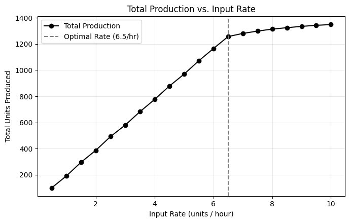
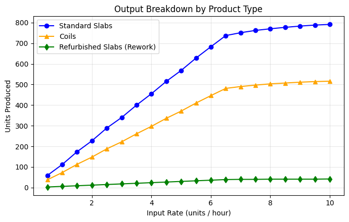
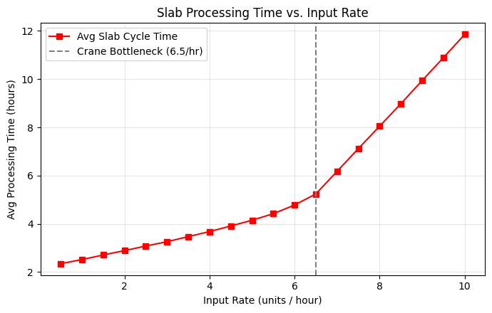

# Steel Manufacturing Process Simulation & Optimization (AnyLogic + Python)

> **Project Status:** part of my academic Industrial Engineering (Modeling and Simulation) program (Fall 2026). 

A hybrid **Discrete-Event and System Dynamics simulation** of a steel manufacturing facility built in **AnyLogic**, paired with a **Python** post-processing pipeline to analyze production throughput, slab processing times, and input-rate optimization experiments.

---

## 1. System Overview & Process Architecture

The simulation models the end-to-end transformation of molten steel into finished **slabs** and **coils**, featuring a real-time **2D animation** where material agents dynamically change color via **Statecharts** and custom Java functions after each manufacturing stage to match output analytics.

### Key Simulation Components
1. **Discrete-Event Production Line:**
   - Models ladle-to-slab casting and downstream rolling into finished coils.
   - Uses **Statecharts** to track material states across processing stages and dynamically synchronize 2D animation colors with dashboard charts.
2. **Resource Reliability & Crane Maintenance (`2 Overhead Cranes`):**
   - **Preventive Maintenance:** Scheduled every `4 days`.
   - **Random Breakdowns:** Stochastic failures modeled with `MTTF = 5 days`.
   - **Repair Duration (`MTTR`):** `1 day`, dynamically adjusting active crane capacity during downtime.
3. **System Dynamics Quality & Rework Submodel:**
   - Connects directly to the `LadletoSlab` sink of the main discrete-event model.
   - Evaluates slab quality with a **5% defect rate** routed into a rework loop (`3-hour` rework cycle time) to produce **Refurbished Slabs**.
4. **Throughput Optimization Experiment:**
   - Sweeps arrival/input rates from **`0.5` to `10.0` units/hour** (step size `0.5`, **500 iterations**) to identify maximum sustainable production before crane and processing bottlenecks saturate the line.

---

## 2. Tracked KPIs & System Parameters

| Parameter / KPI | Role in Model | Description |
| :--- | :--- | :--- |
| **Input Arrival Rate** | Decision Variable | Varied (`0.5` – `10.0` / hr) during optimization experiments |
| **Total Production** | Primary Objective | Combined output of standard slabs, coils, and refurbished slabs |
| **Slab Processing Time** | Efficiency Metric | End-to-end cycle time including queue delays |
| **Slab & Coil Counts** | Mix Breakdown | Product-specific output tracked by color-coded state |
| **Crane Availability** | Capacity Constraint | Governed by `MTTF = 5d`, `MTTR = 1d`, and `4d` scheduled maintenance |
| **Rework Loop Rate** | Quality Stock/Flow | `5%` defect routing with `3h` refurbishment delay in System Dynamics |

---

## 3. Python Data Analysis & Optimization Validation

To complement AnyLogic's built-in charts, Python (`pandas`, `matplotlib`) is used to parse exported experiment logs, identify the optimal input rate where marginal throughput plateaus, and visualize bottleneck effects.

### Optimization & Bottleneck Charts

#### 1. Total Production vs. Input Rate

#### 2. Output Breakdown by Product Type

#### 3. Slab Processing Time & Crane Bottleneck

---

## 4. Repository Contents & Tools
* `simulation_analysis.ipynb` — Google Colab / Jupyter Notebook with step-by-step Python analysis and visualizations
* `simulation_run_anylogic.csv` — Simulation experiment dataset (`0.5` to `10.0` units/hour sweep, 500 iterations)
* **Tools:** AnyLogic (Discrete-Event, Statecharts, System Dynamics) & Python (`pandas`, `matplotlib`)

